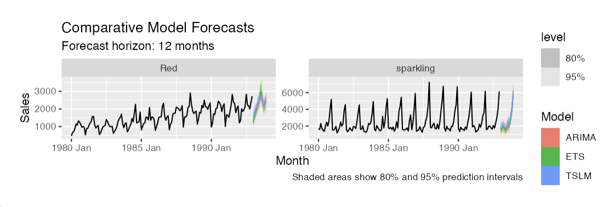

## Part I: Shiny App

**Shiny App:** [Open Australian Wine Sales Forecast](https://zqffpg-danitza-loya.shinyapps.io/australian-wine-forecasting/)

**Code:** [View GitHub Repository](https://github.com/dani-loya/ADS506-AUS-Wine-Forecasting)

### App Features

- **Interactive wine exploration:** Select and compare multiple Australian wine varietals and customize the analysis period.
- **Three forecasting approaches:** Compare TSLM, ETS, and ARIMA models using a user-defined training and validation split.
- **Transparent model selection:** View the automatically selected ETS components and ARIMA orders for each varietal.
- **Model performance comparison:** Evaluate training and validation accuracy using RMSE, MAE, and MAPE.
- **Flexible forecasting:** Adjust the forecast horizon and compare forecasts with 80% and 95% prediction intervals.
- **Best-model identification:** Quickly see which model achieves the lowest validation RMSE for each selected varietal.



## Part II : Data Story

### The Best Forecasting Model on the Wine Varietal

Red and sparkling wine showed noticeably different sales patterns. Sparkling wine had stronger seasonal peaks, while Red wine followed a steadier pattern over time. The forecasting results reflected those differences: ETS had the lowest validation RMSE for Red wine (271.47), while ARIMA performed best for sparkling wine (334.76).

This matters because using one forecasting model for every wine varietal may not provide the most accurate results. Comparing multiple models for each series helps identify the approach that better captures its individual sales pattern.

{width=95% fig-align="center"}

**Reproduce Figure 1:** [Open the Australian Wine Sales Forecast app](https://zqffpg-danitza-loya.shinyapps.io/australian-wine-forecasting/)

### Validation Evidence

| Varietal | Best Model | Model Specification | Validation RMSE |
|---|---|---|---:|
| Red | ETS | ETS(M,A,M) | 271.47 |
| sparkling | ARIMA | ARIMA(0,0,1)(0,1,1)[12] | 334.76 |